# The parts, drawn

Every part an applet imports from `"parachute"`, drawn by the app itself in the default look (Paper), with the code
that draws it. Copy the code; the part follows the person's look, light and dark, a phone and a computer, with no CSS
of yours. The props in full: "The parts" in [WRITE-AN-APPLET.md](WRITE-AN-APPLET.md).
How the look is set, and the tokens if you draw something of your own: [THEME.md](THEME.md). The docs site has the
same page live, in every look (Build → Components).

The pictures come from the app (`docs/components/`, made by an applet that draws each part with made-up content).

## A screen

```tsx
import { Page, List, Button } from "parachute";

export default function Shelf() {
  return (
    <Page title="Reading" aside={<Button small>Sort</Button>}>
      <List label="Reading" rows={[{ key: "1", title: "The Overstory", meta: "Richard Powers" }]} />
    </Page>
  );
}
```

`Page` gives the screen its title (on the type scale), one width and one margin, a way back (`back`), pull to read
again (`onRefresh`), and with `wide` room for a board on a computer (lay its columns out with `pa-grid`, below). Start
every applet with it; the frame adds no margin of its own around a `Page`.

## Button

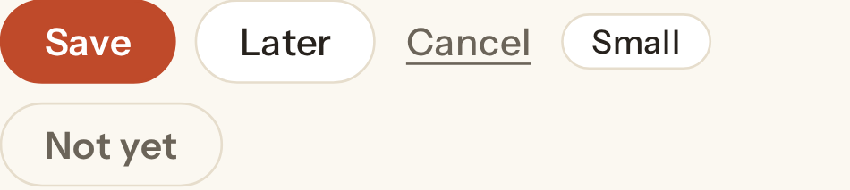

```tsx
<Button kind="primary">Save</Button>
<Button>Later</Button>
<Button kind="quiet">Cancel</Button>
<Button small>Small</Button>
```

One `primary` on a screen: the main action. `plain` (the default) for the rest, `quiet` for a way out.

## Tabs

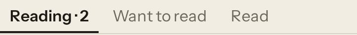

```tsx
<Tabs label="Shelves" current={tab} onChange={setTab}
  tabs={[{ key: "reading", label: "Reading", count: 2 }, { key: "want", label: "Want to read" }, { key: "read", label: "Read" }]} />
```

## List

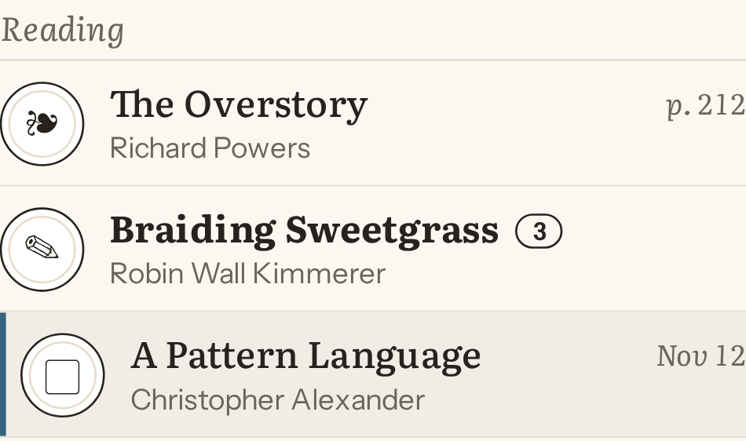

```tsx
<List label="Reading" rows={[
  { key: "1", title: "The Overstory", meta: "Richard Powers", aside: "p. 212", glyph: "❧", onPress: open },
  { key: "2", title: "Braiding Sweetgrass", meta: "Robin Wall Kimmerer", badge: 3, strong: true, onPress: open },
]} />
```

Things of a kind, as rows under a rule: a title, a line under it (`meta`), something at the right (`aside`), a mark
(`glyph`), a count (`badge`), bold for what is new (`strong`), the row open now (`current`). A row with `onPress`
is a button. A count goes in the label (`label={`Active · ${active.length}`}`); under `Tabs` that already name the
list, give `hideLabel` so the name isn't said twice.

## Card

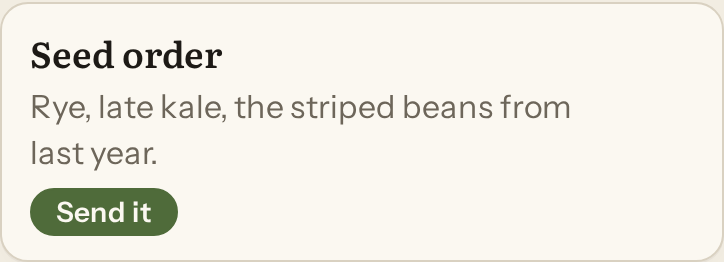

```tsx
<Card title="Seed order">
  <p>Rye, late kale, the striped beans from last year.</p>
  <div className="pa-actions"><Button small kind="primary">Send it</Button><Button small>Later</Button></div>
</Card>
```

A block that stands apart from the rows around it. Use few: rows are not cards.

## Field, Search and Write

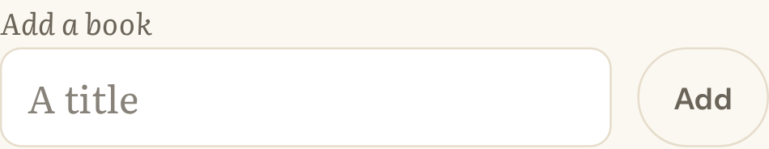
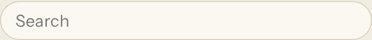
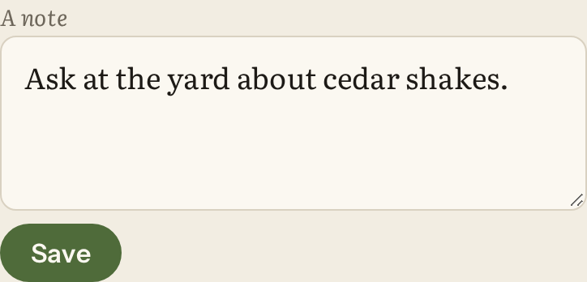

```tsx
<Field label="Add a book" placeholder="A title" action="Add" onAction={add} />
<Search label="Search the shelf" placeholder="Search" onSearch={find} />
<Write label="A note" labelled value={draft} onChange={setDraft} onSend={save} send="Save" />
```

## Table and Fields

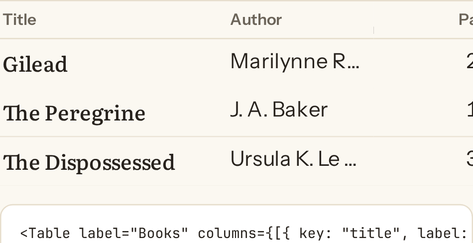
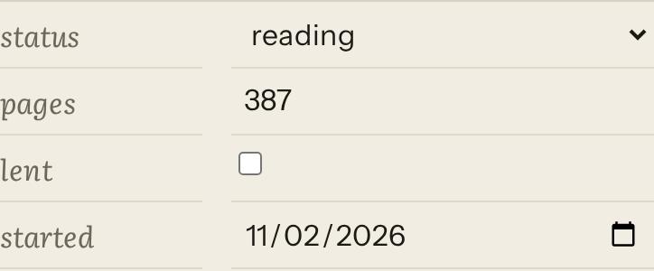

```tsx
<Table label="Books" columns={[{ key: "title", label: "Title" }, { key: "author", label: "Author" }, { key: "pages", label: "Pages", align: "end" }]}
  rows={books.map((b) => ({ key: b.id, cells: b, onPress: () => open(b) }))} />

<Fields label="This book" onSave={save} fields={[
  { name: "status", kind: "choice", choices: ["reading", "want", "done"], value: "reading" },
  { name: "pages", kind: "number", value: 387 }, { name: "lent", kind: "yesno", value: false },
]} />
```

Records as rows and columns; a record's fields, each changed where it stands.

## Days

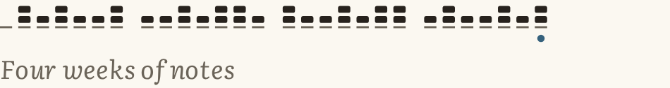

```tsx
<Days times={notes.map((n) => n.updatedAt)} label="Four weeks of notes" />
```

## Empty, Loading and Problem

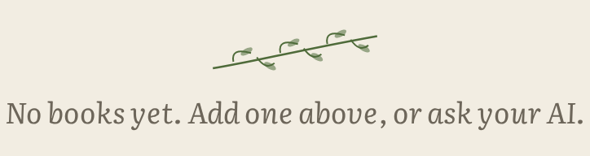
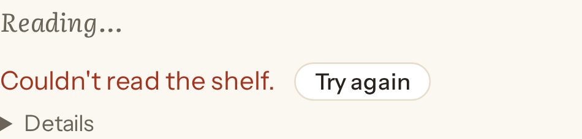

```tsx
<Empty>No books yet. Add one above, or ask your AI.</Empty>
<Loading>Reading the shelf…</Loading>
<Problem error={err} onRetry={load}>Couldn't read the shelf.</Problem>
```

Every state has words: what to do next, what is being read, what failed and Try again.

## Drawer and toast

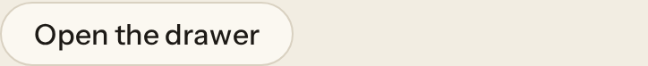

```tsx
<Button onClick={() => setOpen(true)}>More</Button>
<Drawer open={open} onClose={() => setOpen(false)} title="The Overstory">…</Drawer>
toast("Saved");
```

A detail or a short form rises from the foot of the screen; a toast says what an action did. A short form in a
drawer, with no CSS:

```tsx
<Drawer open={!!book} onClose={() => setBook(null)} title={book?.title}>
  <Fields label="This book" fields={[{ name: "status", kind: "choice", choices: ["want", "reading", "done"], value: book?.status }]} onSave={save} />
  <Write label="A line about it" labelled value={line} onChange={setLine} onSend={keepLine} send="Keep" />
  <div className="pa-actions"><Button kind="primary" onClick={finish}>Finished</Button><Button kind="quiet" onClick={() => setBook(null)}>Close</Button></div>
</Drawer>
```

## Laying them out

```tsx
<Page title="Clients" wide>
  <div className="pa-grid">
    <List label="Active" rows={active} />
    <List label="Waiting" rows={waiting} />
  </div>
  <Card title="Next up">
    <p>Call Ada about the second draft.</p>
    <div className="pa-actions"><Button small kind="primary">Done</Button><Button small>Later</Button></div>
  </Card>
</Page>
```

`pa-grid` puts its children side by side when there is room (about 280 px each) and one under another on a phone;
`Page wide` gives a board room on a computer. `pa-actions` puts buttons in a row that wraps. No CSS of yours.

## Plain HTML

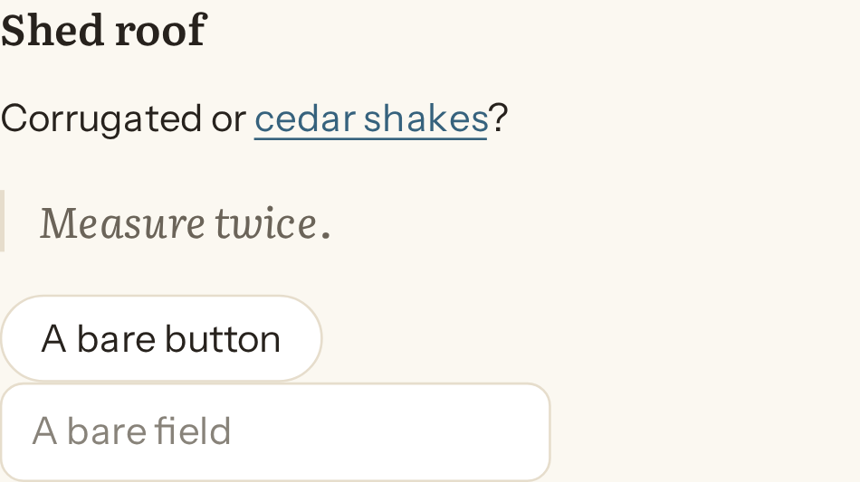

```html
<h3>Shed roof</h3>
<p>Corrugated or <a href="#">cedar shakes</a>?</p>
<blockquote>Measure twice.</blockquote>
<button>A bare button</button> <input placeholder="A bare field">
```

Bare elements are drawn in the theme too, in TSX and in an HTML applet. In an HTML applet the parts' classes work:
`<button class="pa-button pa-primary">`, `<div class="pa-card">`, `<ul>` inside `<div class="pa-list">`.
