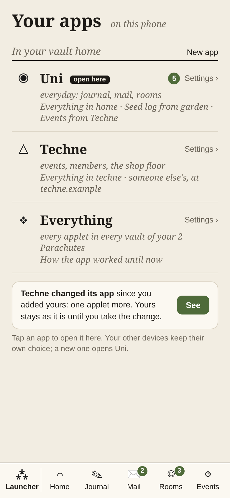
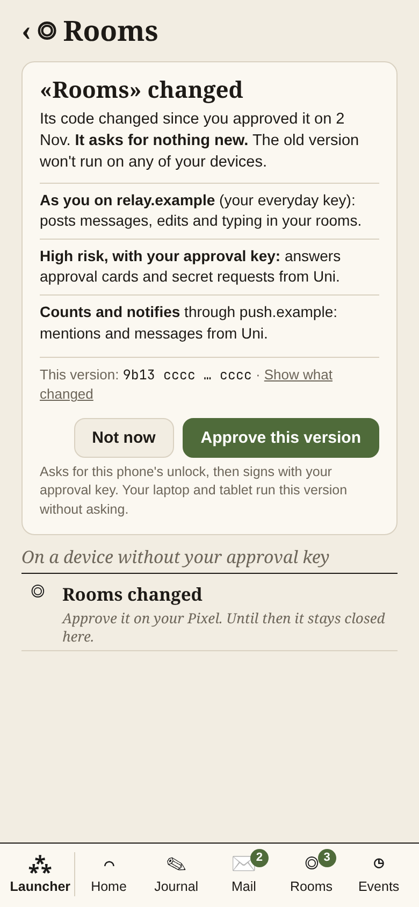

# The app record: what your app is, and what may run in it (design)

Status: a proposal, nothing built. It answers T-476 and its two addenda (11-18): which applets an app loads, what
may run, which keys count and how they are replaced, how careful the app is, what applets keep, and how they tell
you something is waiting. The one-page version is [app-record/DESIGN.md](app-record/DESIGN.md). Schemas, examples
that validate, an attack play and three mockups are in [app-record/](app-record/). Fresh reviewers read it; what
they found and what changed is in [app-record/REVIEWS.md](app-record/REVIEWS.md). Made-up names and hosts throughout
(Aaron, Techne, `uni.example`), as in [EMBED.md](EMBED.md).

## The picture

```
 YOUR HOME VAULT  (follows you to every device)          EACH DEVICE  (stays there)
 ┌───────────────────────────────────────────────┐      ┌────────────────────────────────────┐
 │ Parachute/Apps/uni     AN APP: where applets  │      │ your anchor: the public half of    │
 │      DISCOVERY         come from, the bar,    │─────▶│   your root key. You put it there. │
 │      what is offered   start, what opens what,│ read │ the newest key list and approvals  │
 │                        signals, theme         │      │   it has checked                   │
 │ Parachute/Approvals/…  one per applet: this   │─────▶│ whose each vault is                │
 │      RUNNING           exact code, these asks,│check │ microphone, notifications, unlock  │
 │      what may start    signed by your         │      │ what each applet saved: drafts,    │
 │                        APPROVAL KEY           │      │   where you were                   │
 │ Parachute/Keys         which keys are yours   │─────▶│ which app is open here             │
 │      TRUST             now, signed by your    │check └────────────────────────────────────┘
 │                        ROOT KEY (offline)     │
 │ Parachute/Settings     your Parachutes, and   │        ONE device holds the approval key
 │                        how careful you are    │        and signs, after its unlock.
 └───────────────────────┬───────────────────────┘
                         │ an app lists applets; it never runs one
                         ▼
   everything in home  ·  Seed log from garden  ·  Events from techne.example (someone else's)

 PUSH GATEWAY (named by the applet, on its card): counts what is waiting while nothing runs ──▶ badge, notification
```

1. **An app is a record** in your home vault. It lists where applets come from (one applet, a whole vault, a whole
   hub) and how they are laid out. That is discovery: it decides what you are offered. You can have several apps;
   each device opens one.
2. **Running needs your approval.** Code starts only when a record says "this exact code, asking exactly this",
   signed by your approval key on a real device, after its unlock. One device approving is enough: the others check
   the signature, hash the code themselves, and run it. A vault or hub that is broken into has no key, so it can't
   make your everyday key sign anything new.
3. **Your keys are a short signed list.** Your root key, kept offline, signs which keys are yours now. Replacing a
   leaked key is one signed update that every device reads.
4. **An applet can stop at any moment and lose nothing.** The kit saves drafts and where you were as you go. How many
   applets stay running is then only about speed.
5. **An applet says what counts as "something for you".** A server counts it while the applet is closed. The same
   count is the badge on the bar and the notification on your lock screen.

## What a person sees

From [app-record/mockups/mockup-app.html](app-record/mockups/mockup-app.html) (`?screen=picker`, `settings`,
`approve`).

| Your apps | One app's settings | Approving a change |
|---|---|---|
|  |  |  |

**What to judge.** First: does "an app" read as a thing you pick, and is *Everything* a fair name for how it works
today? Second: do the three "Applets from" lines say wildcards in words you would use, and is "New: Ideas. Tap to
look" the right weight for an applet that turned up? Third: is the card clear that one approval covers every
device, and is "Approve it on your Pixel" acceptable on a device without the approval key? (Open question 1.)

## Listed or linked

| | **A. One list** | **B. Links** |
|---|---|---|
| The shape | One app record holds everything: sources (with wildcards), bar, start, opens, signals. | The app record is a title. Each applet in it is its own pointer record linked to the app. |
| "Every applet in home" | One line. A new applet is offered by itself. | No wildcard. A button writes nine pointers; the tenth applet needs a tenth. |
| Reorder the bar | One write. | Up to twelve writes that must all land. |
| Two devices change it at once | The second write is told to read again (`if_updated_at`, as Settings does now). | The bar can end up half one order, half the other. |
| Your agent sets up an app | Writes one record. | Writes one per applet and keeps them in step. |
| Seen in the vault | One note to read. | The graph shows which apps use an applet. |

**Recommendation: A.** Aaron's words ask for wildcards, and B can't have them. And the choice matters less than it
looked: the version you trust is in neither. It is in the signed approval, the only thing that lets code start.
Listing is discovery; the signed hash is trust.

**Do graph links add anything?** One thing, and it comes free: an approval is its own note per applet, so the app
links it to the applet's note when both are in one vault, and the graph shows what you approved. Nothing reads those
links to decide anything. An applet in Techne's vault can't be linked from yours; it is named by address, as the bar
names it today.

## Layer 1: the app record (discovery)

`Parachute/Apps/<id>` in your home vault, tagged `parachute-app`, everything under `fields.app`
([schema](app-record/app.schema.json)). The type is called an app; the tag has the prefix because people already
tag their own notes `app`. Applets can't write it: their writes change a note's words, never its fields, and the
three new tags join those whose notes an applet may not touch (`GUARDED_TAGS`, `src/applet/modules/vault.ts`). Your
agent can write it, and that is safe: nothing in it lets code start.

| Key | What it says |
|---|---|
| `id`, `name`, `glyph`, `note` | What the picker shows. |
| `sources` | Where applets come from (below). |
| `hide` | Applets a wildcard brings that this app leaves out. |
| `bar`, `start` | As in `Parachute/Settings` today: up to 12 places, and the home applet. Open-on-start still needs this device's tap (`start.ts`, unchanged). |
| `opens` | Which applet opens a kind of note ([below](#what-opens-a-note)). |
| `services` | The servers this app's applets reach, as Settings lists them today. |
| `theme`, `frame` | Which theme and frame record this app wears. A frame is code: it needs an approval too. |
| `keep` | How many applets stay running: `"auto"` or a number (layer 3). |
| `signals` | Which applets badge, notify or stay quiet (layer 4). Choices only; no server address. |
| `based_on` | Set when you added an app someone else offers: where the copy came from. |

**Sources.** One shape, `{ hub?, vault, applet }`, the same as a place on the bar. A `*` widens it:

```json
"sources": [
  { "vault": "home", "applet": "*" },
  { "vault": "garden", "applet": "Applets/SeedLog" },
  { "hub": "https://techne.example", "vault": "techne", "applet": "Applets/Events" },
  { "hub": "https://uni.example", "vault": "*", "applet": "*" }
]
```

Every applet in a vault; one applet; one applet in someone else's vault; every vault on a hub. No hub means the hub
your home vault is on. There is no "every hub" and no "this applet in every vault".

**How the app reads it**, each time it shows the launcher:

1. Pick the app: this device's choice, else `Settings.app`, else the only one, else the picker.
2. For each source, list what this device can see. A hub it isn't signed in to is one line with **Sign in**, as now.
3. Take away `hide`. Group as now: by Parachute, then vault; someone else's is marked.
4. `bar`, `start`, `opens` and signal rules that name an applet outside the list are skipped, not errors.
5. Tap one. It starts if a signed approval covers this exact code and these exact asks. Otherwise its card.

**Wildcards and changed code.** A wildcard decides what is *offered*. An approval decides what *runs*.

| What happens | What you see |
|---|---|
| A new applet appears in a vault you listed with `*` | "New: Ideas in playground. Tap to look." Its card on first open. None of it has run. |
| An applet's code changes | It stops on every device. "«Rooms» changed" (third mockup). One approval, on one device, and all of them run the new version. |
| It asks for something else | The same, headed "«Rooms» asks again", with what is new marked. |
| It is in someone else's vault | The same rule. It stays marked, asks nothing of the app, and never opens by itself ([EMBED.md](EMBED.md) otherwise unchanged). |

**Several apps.** Each is one record: *Uni* for every day, *Techne* for the shop. A device remembers which one it has
open. A new device opens `Settings.app`. The picker is the launcher's title, tapped. A vault that no source of the
open app names is reached through *Everything* or Settings.

**An app someone else offers.** Techne can keep an app record in its own vault. Your launcher offers **Add**. That
copies it into your home vault with `based_on`, its sources rewritten to name Techne's hub. The copy is yours: when
Techne changes theirs, the picker says so and shows what differs. (An app that follows Techne is open question 2.)

**What stays in `Parachute/Settings`:** what is yours, not one app's: `hubs` (your Parachutes), `app` (the app a new
device opens) and `security` ([below](#security-levels)).
[Schema](app-record/settings.schema.json).

### What opens a note

Aaron: "When we click a parachute note in one applet, what applet does it open in? And how is that specified?"

Today: an applet's record says what it *can* open (`opens: [{ type, path }]`); a tap opens the applet that opens the
note's kind; long-press offers **Open with…**; "Always" is remembered on one device (`parachute.openwith.v1`).

With the app record, in this order:

1. **This device's "Always"** for that kind in that vault, if you set one here.
2. **The app's `opens`**: your choice for every device. `{ "type": "task", "vault": "home", "applet": "Applets/Tasks" }`,
   or `"applet": null` for the plain view. The first time you choose "Always", the app offers "On your other
   devices too?" and writes it here.
3. **The only applet in the open app** that says it opens that kind in that vault.
4. Several say so and you chose none: **Open with…** asks, once.
5. None: the plain view.

**A link to a note in another vault** follows the same steps for *that* vault. Only an applet that lives in a vault
can read it, so the note opens in an applet from its own vault, or plain. If this device isn't signed in there, the
link says so with **Sign in**. A choice naming an applet that doesn't declare the kind is skipped.

## Layer 2: running needs a signed approval

Aaron: "Code change should definitely wait for a yes… If the parachute gets compromised, we need to make sure that a
real client (could just be one client, doesn't need to be all) approves a code change. Otherwise a compromised
parachute vault could mean your nostr key starts getting used in a lot of places you don't want it to."

Today an Allow lives in one device's `localStorage` (`src/applet/grants.ts`): a tap, with no key behind it, that
every device asks for again.

**The rule.** Vault code starts on a client only when that client holds an approval that:

1. is signed by a key that **your key list** names as an approval key ([Keys](#keys-and-replacing-them));
2. names **this record** (hub, vault, record id);
3. names **the hash of this exact code** and **the hash of everything it asks**, both computed by the client itself
   from what it is about to run;
4. is **newer than any other approval the client has seen** for that record;
5. has not run out (a year at most), and agrees with this device on whose the vault is.

Anything else, and the card shows instead.

**What the two hashes cover.**

| Hash | Covers |
|---|---|
| Code | The record's code and every component it imports, each under the name it is imported by (as `compositeHash` does today). |
| Asks | The record's own fields as written: manifest (folders and verbs, microphone), `opens`, `app` words, `services` (addresses, what it may sign, approvals), `signals`, `embeds`; with the hub's address, the vault's name and the record's id. |

Not in either, and why it is safe: the kit and the transpiler ship with the app. A component *embedded* on a page
runs in its own frame, so it has its own approval. Your own frame (`Parachute/Frame`) is code too: its own approval.
So one rule covers every piece of vault code, and the three device-held Allows of today (applet, embed, frame)
become one kind of record.

**The record.** One per piece of code: `Parachute/Approvals/<host>/<vault>/<record id>`, tagged
`parachute-approval` ([schema](app-record/approval.schema.json)). It holds one Nostr event, never sent to a relay.
It says what kind of code it is of (applet, component, frame), so one can't stand in for another. Its number `n` is
the time of signing, or one more than the approval it replaces, whichever is larger; so a device that lost its
memory still signs higher. A number from the future is refused. Taking an approval back is the next one, saying
`"approved": false`.

**Approving** (third mockup). Today's card, then the device unlock, then native code signs with the approval key.
The unlock is never skipped for this, whatever the security level. A changed applet costs one unlock, on one device.

**What an approval does not do.** It proves *you* said yes. It does not prove the code is good. "It asks for nothing
new" is true of a change that misuses what Rooms already has. So the card says so, and **Show what changed** shows
the difference from the version you last approved, which each client keeps for that purpose.

**A client keeps what it checked.** Each verified approval is kept on the device. A vault that later deletes or
garbles the record changes nothing there: only a newer signed record, a key list that drops the key, or the year
running out stops code.

**A device without the approval key** checks and runs, but can't approve. It says "Rooms changed. Approve it on
your Pixel." (Open question 1.)

### Tested against attacks

[attacks.mjs](app-record/attacks.mjs) plays the rule with real keys, real signatures and hashes computed from the
code: 47 attempts. It tests the rule's logic. It can't test the app, the native signer or the unlock, which don't
exist. [mutate.mjs](app-record/mutate.mjs) then turns off each of the rule's 24 checks in turn: without 14 of them
the play fails. The other 10 it does not notice: six only refuse malformed records, and four are second lines
behind another check. It prints which.

| Who | Tries | Result |
|---|---|---|
| Someone who can write your vault (a token, an agent, the hub itself) | New code, approval left alone | Doesn't run: the hash differs. |
| | A changed component that the applet imports | Doesn't run: the hash differs. |
| | New code, and the hash inside the approval edited to match | Doesn't run: the signature breaks. |
| | New code, approved with a key of their own; or a key list naming their key | Doesn't run: not signed by your root. And it doesn't push out the approval the client holds. |
| | Same code, wider asks (another server, another kind it may sign) | Doesn't run: the asks' hash differs. |
| | Rooms' approval copied onto another applet | Doesn't run: it names Rooms. |
| | **Rollback:** October's approval and October's code put back | Doesn't run on a client that saw November's. |
| | An approval you took back, put back | Doesn't run on a client that saw you take it back. |
| | Deleting approvals | Nothing stops on clients that had checked them. A new client asks. |
| Someone who also holds your **everyday** key | Approves with it, or signs a key list promoting it | Doesn't run: the list gives that key the everyday role only. |
| Techne | Changes an applet you approved, or a component on your home page | Doesn't run until you approve the new hash. Same rule, same record. |
| Your agent's token, or a thief's | Changes your own frame | Doesn't run: a frame needs an approval too. Nor can a record approved as a component be passed off as a frame. |
| A device with a wrong clock, or a thief before you notice | Signs with a number from the far future, to block every later approval | Refused. And what a dropped key signed orders nothing. |
| Two of your devices at once | One approves and one withdraws in the same second | Each client keeps the one it saw. The vault's own write check makes the second signer read again and sign higher. |

**Three gaps that remain.**

- **A client can't know what it isn't shown.** If the vault hides your withdrawal from a laptop that hasn't read it
  yet, the laptop keeps running that code until the year ends. It is code you approved.
- **A brand-new client has seen nothing.** Served October's approval with October's code, it runs them. Code you
  approved, asking what you approved; never new code.
- **A stolen approval key and a broken-into vault together.** If the vault also hides your new key list, a client
  that hasn't read it believes the stolen key. That is why the key list also goes to your relay: it is public keys
  only, a client reads both, and warns you when they differ.

### A stolen or broken device

If it held the approval key, that key is the thief's until you replace it. Getting out:

1. With your root key, sign a key list that names a new approval key and drops the old one
   ([below](#keys-and-replacing-them)).
2. Each device reads the list. From then, nothing the old key signed counts there, whenever it was signed.
3. **Approve again from a device the thief never held, not from the vault.** That device shows what *it* was
   running: the approvals it had checked before the day you say the key was lost. One unlock signs those. Anything
   the old key signed after that day is shown apart, one at a time, with what changed, because the thief may have
   signed it.
4. What Uni sealed to the old approval key is sealed again, as KEYRING.md already says of losing it.

A device that held only the everyday key: replace that key the same way. It could never approve code.

### What the code needs for this to hold

1. **The asks' hash must be the same on every client.** Today it isn't: `grantKey` takes this device's own name for
   the vault (`home`, or `home@host`) and what this device says of other vaults, and hashes parsed values that two
   app versions can parse differently. The new one hashes the fields as written.
2. **Approvals and key lists need event kinds of their own** (30479 and 30480 in the examples). The native signer
   already signs for applets with both keys: kind 30078 with the everyday key (`private_save`), and seals and
   approval requests with the approval key (`cards.rs`, http `approve`). None of those paths may be able to produce
   the new kinds; a test says so.
3. **Native code signs what the web shell hands it.** So the system's own unlock prompt names the applet and the
   start of the hash, where the platform lets it (KEYRING.md: Linux and Windows show a plain OK/Cancel). A shell
   broken on the approving device is a stolen device, as above.
4. **A way to put the anchor on a device** (next section). Today's pairing only receives the everyday key from the
   Uni app or Buzz desktop (`src-tauri/src/pairing.rs`); it can't carry this.
5. **Device modes go.** Today a grant remembers whether the device was *sealed* or *approved-code*. Under this rule
   every device runs only approved code, so the card always carries the phone's warning ("on a phone an applet
   could send what it reads to the internet").

### What stays on each device, and why

| Stays per device | Why |
|---|---|
| The anchor, the newest key list and the approvals it checked | They are what a client checks the vault *against*, so they can't come from the vault. |
| The approval key and the device unlock | The unlock means a person is holding this device now ([KEYRING.md](KEYRING.md)). |
| The microphone, notifications | The phone's own permission. Nothing we store can answer for it. |
| Whose each vault is | The person's say on the app's own screen. If two devices disagree about a vault, its code doesn't run on the one that differs, and it says why. |
| Which app is open, open-on-start, "Always open with", the keep-running override | Choices about this device. Each wins over the record here. |

**A new device:** bring your everyday key in (pairing, as now), put your anchor on it, sign in to your home hub.
It reads your key list, your app and your approvals, checks them, and your applets run. It asks nothing about code
you already approved. The microphone and notifications ask when first used.

## Keys, and replacing them

Aaron: "If we ever hit a point where my nostr private key gets leaked, I want to be able to quickly and effectively
rotate that… at some point before too long I'll want to rotate my own nostr private key and make sure the system all
keeps working well."

**Three keys**, with the names agreed with #systems:

| Key | Where | Does | Needs |
|---|---|---|---|
| **Everyday key** | every device, and other software you run (Uni) | signs you in, posts, signs requests as you, for approved applets only | nothing while the app is open (a security level can ask more) |
| **Approval key** | one device (open question 1), its own secure slot | approves code; answers approval cards | the device unlock, every time for code |
| **Root key** | offline, never in the app | signs the key list | you, and wherever you keep it |

**The key list.** One record, `Parachute/Keys`, tagged `parachute-keys` ([schema](app-record/keys.schema.json)),
also posted to your relay. It holds one event signed by the root key: which keys are yours now, each with one role.
A key not on the list signs nothing that counts, and the app stops signing with an everyday key that is off it.

```json
{ "v": 1, "seq": 1793527200, "at": "2026-11-01T10:00:00.000Z",
  "keys": [ { "role": "everyday", "key": "<hex>", "name": "phone, laptop, Uni" },
            { "role": "approval", "key": "<hex>", "name": "phone" } ] }
```

**Making a root key** (Settings → Keys → **Make a root key**, once). The app makes it, shows it as words to write
down and keep somewhere that is not a device, and forgets it. Its public half stays: that is this device's anchor.

**The anchor.** Each device holds the root key's public half. You put it there when you set the device up: scan it
from a device you hold, or paste it. It is public, and both screens show the same short code to compare. This is the
one thing a device takes on your word. Everything else it checks against that.

**Signing a new list.** Two ways. Type the root key's words into the app, which signs once behind the device unlock
and forgets them; or sign on a machine that is never online, and scan the result in. The first is quick, and the
root key is in a phone's memory for a moment. The second is what "offline" really means. #systems' runbook should
say which.

**Replacing a key you still control** (the planned case: Settings → Keys → **Replace a key**). Nothing stops:

1. The app makes the new key. A new list names the old and the new together. You sign it.
2. A new approval key: one screen, one unlock, and every approval is signed again with it. A new everyday key: each
   device gets it by pairing, and each service is told (below).
3. A last list drops the old key. From the moment a device reads it, nothing the old key signed counts there.

**Replacing a key that leaked.** Skip step 1's overlap: one list that drops it now. Its signatures stop counting at
once, old ones too, because a leaked key can sign with any date. Applets stay closed until you approve them again
from a device you trust ([a stolen device](#a-stolen-or-broken-device), step 3).

**If the root key is lost,** nothing breaks, but the list can't change. Make a new root key and put the new anchor
on each device by hand. **If the root key leaks,** do the same, at once.

**The interface with #systems.** The key list is the one thing both sides read: a public, root-signed event that
says "these are this person's keys now", in the vault and on the relay the app's `services` name. The app's side is
making, checking and obeying it. Theirs, which I did not design or check:

- Each service needs the anchor once, as each device does.
- A new everyday key is a new public key. Relay memberships, the hub's roles on each vault, and the trusted keys
  named inside applet records all name the old one. Applets whose records change will ask again.
- KEYRING.md plans the approval key as "the second signature #systems uses for root actions". That stays. The root
  key here signs one thing only: the key list.

**For someone with no root key** (most people): the anchor is their approval key, which signs the list itself.
There is then nothing above it: if it is lost or stolen, each device is set up again by hand. Nothing here asks
them to do more.

## Security levels

Aaron: "we probably want to have a better default level of security, like we've had in Uni app where I have to enter
my pin or my fingerprint to approve something… I might want to be able to require a password to do anything if I
haven't touched it for X many minutes."

`security` says how careful your app is. It is yours, not one app's, so it sits in `Parachute/Settings` and holds
for every app and device. (The brief said "part of the app record, per person"; with several apps, per person means
Settings.) Each device enforces it.

| Setting | Default | The other choice |
|---|---|---|
| Approving code | **device unlock, always** | None. No setting turns it off. |
| Powerful answers from the approval key | **device unlock, each one** | None, as today. |
| `answers`: routine answers from the approval key (approval cards) | `"each"`: unlock for each one, as the Uni app does | `"five-minutes"`, looser: once per applet, then not again for five minutes. This is what Parachute does today, so the default gets stricter. |
| `lock_after_idle_minutes` | `null`: never | A number: unlock to open the app after that long untouched. Aaron's "password to do anything". |
| `everyday` | `"open"`: the everyday key signs for approved applets while the app is open | `"unlock"`: each applet's first signature after the app was locked needs the unlock. |

**A record can make a device stricter by itself, never looser.** Your agent can write this record, so a device
applies the stricter of the record and what it already held, and going looser takes that device's own unlock. On a
stolen phone the approval key is behind the unlock whatever is set; with the idle lock, so is everything else.

## Layer 3: an applet's state survives everything

Aaron: "if I'm journaling and then hop to mail then messages and then rooms, I don't want to lose my journal entry.
Even if I close my app or turn off my phone."

Today an applet may ask for `storage` (256 KB in `localStorage`), and three hidden applets stay running (`KEEP = 3`,
`src/shell/kept.tsx`). Nothing is saved when a fourth pushes the first out. A draft survives only if the applet's
author thought to save it.

**The guarantee.** What an applet gives the kit to save reaches the shell within 300 ms of changing, the shell
writes it to this device's disk at once, and it is handed back before the applet's first paint, whether it was hidden, unloaded, the app closed or the phone restarted.

```tsx
<textarea {...saved("draft:" + roomId)} />                  // saved as you type
const [tab, setTab] = useSaved("tab", "inbox");             // where you were
```

- **Saved as you go, not on the way out.** The kit sends each change to the shell, at most 300 ms late. Nothing
  depends on an exit running, which is the only promise that survives the phone killing the app. At worst the last
  300 ms of typing is lost.
- **One last flush, where there is a moment for it.** The kit flushes when its frame is hidden, when the app goes to
  the background, and when the shell is about to unload it (every applet, not only kept ones). The shell waits up
  to 250 ms for the answer, then unloads anyway.
- **Handed back at start.** Saved values arrive in the message that starts the applet, so it paints its draft at
  once. The kit also saves the screen the applet was on and its main scroll position.
- **Only what goes through the kit.** A plain `useState` box is lost as today. So step 1 of the migration converts
  our own applets: Journal's entry box, Rooms' and Mail's composers. WRITE-AN-APPLET.md makes `saved()` the way to
  write a text box.
- **Every approved applet gets it,** someone else's too: it is the applet's own data on your own device. That
  changes EMBED.md, which gives someone else's applets no storage. The `storage` word stays and means the same store.
- **The store** moves out of `localStorage` (5 MB for the whole app) into the app's own data: a file per applet on
  phone and desktop, IndexedDB in a browser. 1 MB per applet, of which 256 KB is held back for drafts so a cache
  can't crowd one out. A full store refuses the write and the kit tells the applet. Keyed hub + vault + record, on
  this device. **Forget this vault** clears it, and each applet's settings get "Clear what it saved"; neither
  happens today. Taking an approval back does not clear it.

**Saved state stays on the device.** A draft that should follow you is saved by the applet as a real note in its own
folder, as Journal does with an entry. Syncing drafts for every applet would be a new mechanism, and a half-written
message turning up on another device is a surprise.

**Then keep-alive is only speed.**

- **Default `"auto"`: a count by device.** 6 hidden applets on a phone, 12 on a desktop; all but the newest dropped
  when the native side is told memory is short (Android has such a signal; I did not check the others). A count,
  not measured memory, because a web view can't reliably say what one frame costs (inferred, not measured).
- **The setting:** `keep` in the app record (`"auto"`, or 0 to 12), with an override on each device.
- A running applet keeps its connections open. That is the cost, and why an old phone might choose 2.
- What may be kept at all (own code, no embeds, no note handed in) stays as `kept.tsx` has it.

## Layer 4: "something for you"

Today only Rooms reaches you while closed. Its relay service carries `notify: { mentions, from, gateway }`; the push
gateway watches the relay and pushes "a message for you", no words, no count. Nothing shows a badge.

**The applet declares its signals** in `fields.signals`, beside its manifest
([schema](app-record/signals.schema.json)): an id, a name in plain words, how it counts, where from, and the gateway
that counts it.

```json
"signals": [
  { "id": "for-you", "name": "mentions and messages from Uni", "count": "new", "via": "https://push.example/",
    "from": { "service": "rooms", "mentions": true, "authors": ["3f1c…2b4d"] } }
]
```

| `from` | Counts | Who counts while the applet is closed |
|---|---|---|
| a relay service the applet declared | events naming you, or from keys this device trusts; `new` since you last looked | The gateway, as today, in the rooms it has been added to. |
| an http service it declared (`feed`) | a number that server reports | The server tells the gateway. The gateway never holds your mail login. New on both sides. |
| its own vault (`path`, `type`, `where`) | how many notes match now | Later: needs the hub to tell the gateway when a query's answer changes. Until then the app counts it each time the launcher shows. |

The gateway stays on the applet, as `notify.gateway` is today. So it is on the card and in the asks' hash: a
rewritten record can't send your phone's address to a stranger's server, and two relays can use two gateways. An
applet in someone else's vault reaches no service, so it may declare only the vault kind, counted while the app is
open.

**The gateway keeps one number** per person, applet and signal.

**The app shows it without running the applet.** At start, on each push, and when the window comes back to the
front, the shell asks the gateway for your counts in one signed request. The bar and launcher draw them.

**The applet's own number wins while it runs.** Rooms knows what you have read; the gateway only knows what arrived.
Running, the applet sets the number and the shell tells the gateway, which tells your other phones, so a badge read
on one clears on the others.

**The same signal is the notification.** The push says which applet, which signal and the count. The phone words it
from the applet's own record: *Rooms · 3 new: mentions and messages from Uni*.

**In the app record**, `signals` holds your choices only:

```json
"signals": {
  "default": "badge",
  "rules": [
    { "vault": "home", "applet": "Applets/Rooms", "signal": "for-you", "show": "notify" },
    { "hub": "https://techne.example", "vault": "techne", "applet": "Applets/Events", "show": "off" }
  ]
}
```

`notify` is a badge and a notification; `badge` is quiet; `off` isn't registered at all. A device registers the
signals of all your apps, so opening the Techne app doesn't quiet Rooms; the bar shows badges for the app that is
open. One exception, for approval requests (a signal on a service that carries `approvals`): a record can't turn
them off, only the device can. So an agent can't quiet its own approval cards.

**What it costs.** The gateway already knows your public key and your rooms. It would also learn which applets you
use, your mail's unread count, when you open the app and roughly when you read. It never sees words. A desktop gets
no push while closed (as today), so its badges are fresh at start and when you come back to the window, not live. A
room the gateway hasn't been added to never counts.

## Worked examples

All in [app-record/examples/](app-record/examples/), checked by [validate.mjs](app-record/validate.mjs).

- [app-uni.json](app-record/examples/app-uni.json): the everyday app in the mockups (below).
  [app-everything.json](app-record/examples/app-everything.json): today's behaviour as an app; what migration
  writes. [app-techne.json](app-record/examples/app-techne.json): an app added from Techne's vault.
- [keys.json](app-record/examples/keys.json): a key list, signed by a root key.
  [settings.json](app-record/examples/settings.json): what stays in Settings, with `security`.
- [approval-rooms.json](app-record/examples/approval-rooms.json): Rooms' approval, its hashes computed from the code
  and fields in [sign-examples.mjs](app-record/sign-examples.mjs).
  [approval-events-from-techne.json](app-record/examples/approval-events-from-techne.json): someone else's vault.
  [approval-your-frame.json](app-record/examples/approval-your-frame.json): your own frame.
  [approval-scratch-withdrawn.json](app-record/examples/approval-scratch-withdrawn.json): one taken back.
  [approval-on-a-hub-with-a-port.json](app-record/examples/approval-on-a-hub-with-a-port.json). Real
  signatures, from keys made for the examples and thrown away.
- [signals-rooms.json](app-record/examples/signals-rooms.json),
  [signals-mail.json](app-record/examples/signals-mail.json),
  [signals-tasks.json](app-record/examples/signals-tasks.json): the three kinds of signal.
- [settings-while-devices-overlap.json](app-record/examples/settings-while-devices-overlap.json).
- [examples/invalid/](app-record/examples/invalid/): 26 records that must be refused, and are. Among them: every
  hub, a hub with a `*` in it, a version pin slipped into a source, a gateway slipped into the app, a theme that
  points at the approvals, a security setting that drops the unlock, a forged approval, a ten-year one, one moved
  onto another applet, a key list with a swapped key, a key with two roles.

```json
{
  "path": "Parachute/Apps/uni",
  "tags": ["parachute-app"],
  "fields": {
    "app": {
      "contract": 1,
      "id": "uni",
      "name": "Uni",
      "glyph": "◉",
      "note": "everyday: journal, mail, rooms",
      "sources": [
        { "vault": "home", "applet": "*" },
        { "vault": "garden", "applet": "Applets/SeedLog" },
        { "hub": "https://techne.example", "vault": "techne", "applet": "Applets/Events" }
      ],
      "hide": [{ "vault": "home", "applet": "Applets/Scratch" }],
      "bar": [
        { "vault": "home", "applet": "Applets/Journal" },
        { "vault": "home", "applet": "Applets/Mail" },
        { "vault": "home", "applet": "Applets/Rooms" },
        { "hub": "https://techne.example", "vault": "techne", "applet": "Applets/Events" }
      ],
      "start": { "vault": "home", "applet": "Applets/Home" },
      "opens": [
        { "type": "journal", "vault": "home", "applet": "Applets/Journal" },
        { "type": "task", "vault": "home", "applet": null }
      ],
      "services": [
        { "name": "Rooms", "kind": "nostr-relay", "url": "wss://relay.example" },
        { "name": "Mail", "kind": "http", "url": "https://mail.example/mail/" }
      ],
      "theme": "Parachute/Theme",
      "keep": "auto",
      "signals": {
        "default": "badge",
        "rules": [
          { "vault": "home", "applet": "Applets/Rooms", "signal": "for-you", "show": "notify" },
          { "hub": "https://techne.example", "vault": "techne", "applet": "Applets/Events", "show": "off" }
        ]
      }
    }
  }
}
```

What an approval's signed content says (in the record it is one string, which is what the signature covers):

```json
{
  "v": 1,
  "subject": { "hub": "https://uni.example", "vault": "home", "record": "01M7ROOMSAPPLET", "applet": "rooms" },
  "n": 1794994200,
  "approved": true,
  "code": "tsx:<hash of the code and what it imports>",
  "scope": "<hash of what it asks>",
  "whose": "mine",
  "at": "2026-11-18T09:30:00.000Z",
  "expires": "2027-11-18T09:30:00.000Z",
  "face": ["As you on relay.example (your everyday key): posts messages, edits and typing in your rooms…", "…"],
  "others": [],
  "device": "Pixel"
}
```

## From today to this

1. **Saved state first.** It is the sharpest pain and touches nothing else. Move `storage` to the new store (copy
   `parachute.applet-storage.v1:*` once), add `saved()` and `useSaved`, the flushes, the wait before unload; convert
   Journal, Rooms and Mail; raise the keep-running default.
2. **Apps, read only.** With no app record, the app behaves exactly as now: it reads Settings as an unwritten
   *Everything* app (every hub in `hubs`, `*`, with its bar, start and services).
3. **Apps, written.** The first change (a pin, a new app) writes `Parachute/Apps/everything`. While old and new
   devices overlap, the new app keeps Settings' `bar`, `start` and `services` in step with the app named in
   `Settings.app`, and leaves a hash of what it wrote (`mirror`) in Settings. If the three no longer match it, an
   old device changed them, and the change is taken into the app record. `install-applets.ts` learns `--app`.
4. **Opens.** A device's "Always" choices stay and keep winning there; the app record is offered them once.
5. **Applet pointers.** Each `Parachute/From/…/applet-*` pointer is read as a one-applet source; its pinned hash is
   what the approval now carries, signed. The records stay until the overlap ends, so an old device keeps its
   brought-in applets. Component pointers stay for good; embeds own them.
6. **Keys, then approvals.** A separate approval key if there isn't one; the anchor on each device; a key list if
   you keep a root key. Then one screen on the approving device, "Sign what you allowed here", with one unlock. It
   lists only applets whose code is still what that device allowed; a changed one shows its card. A signed approval
   keeps the end date its grant had. Until a device has its anchor it keeps its local grants and
   asks for itself, as today, so nothing stops working on the day of the update.
7. **Signals.** Rooms' `notify` becomes a signal; the gateway learns counts. Rooms asks once more, because what it
   asks is worded anew.
8. **Security levels.** `security` in Settings. The idle lock is new, and routine answers get stricter by default
   (an unlock each, where today there is a five-minute grace).

**Subtract** (what this replaces, and when the old one goes):

| Old | Replaced by | Goes |
|---|---|---|
| `bar`, `start`, `services` in `Parachute/Settings` | the app record | when no device of yours runs the old app. How the app knows that is not designed: each device would have to leave its version somewhere. Until it is, a date Aaron sets. |
| Applet pointers (`Parachute/From/…/applet-*`) | a source, and the code hash in the signed approval | same day |
| Grants in each device's `localStorage` (`parachute.applets.grants.v1`), and the frame's and embeds' own Allows | signed approvals in the home vault | per device, when it has its anchor; a browser tab with no key keeps them |
| `grantedUnder` (sealed / approved-code) on a grant | nothing: every device runs only approved code | at step 6 |
| "Your approval key is your everyday key for now" (KEYRING.md) | a separate approval key | at step 6 |
| `parachute.applet-storage.v1` | the saved store | at step 1 |
| `KEEP = 3` | `keep` | at step 1 |
| `services[].notify` | `fields.signals` | one release after step 7 |
| "The launcher is for everything" (NAVIGATION.md rule 2) | the launcher is your app; *Everything* is one | at step 3 |
| "Always open with: never in a note" (`src/open/defaults.ts`) | still true per device; the record adds a default | at step 4 |

## Decided here, unless you say otherwise

Each of these is a choice someone could reasonably make the other way.

- **A separate approval key becomes required** to use signed approvals. Today it is optional, and for most people
  it is the everyday key, which other software holds. Cost, from KEYRING.md: everything Uni sealed to the old key is
  sealed again.
- **Approvals last a year.** Shorter narrows the first gap above and asks more often.
- **The gateway learns** which applets you use and your mail's unread count, not only your rooms.
- **Drafts stay on the device.**
- **Device modes go**; the card always carries the phone's warning.
- **A device with no anchor** (a browser tab, or any device before you set it up) can't check approvals. It keeps
  today's behaviour: its own Allow, by a tap, for itself only.
- **`security` sits in Settings, not in each app record.**
- **Not designed here:** Aaron would drop reactions from Rooms. That takes kind 7 out of what Rooms may sign, which
  changes what it asks, so Rooms would ask once.

## What I did not verify

- The #systems side of key replacement: that the hub, relay, Hermes and mail can be made to obey a key list.
- That the system's unlock prompt can show a line of our choosing on Android and macOS.
- That Android phones are *approved-code* devices today. One line of EMBED.md says so; I did not read the self-test.
- That the hub can tell a server when a query's answer changes. I did not read the hub's code.
- That a web view can't measure one frame's memory. It is why I chose a count.
- That kinds 30479 and 30480 are free in the Nostr kind list. Any unused kinds do.
- A mail server reporting a count to the gateway does not exist yet, on either side.

## Open questions for Aaron

1. **Does the approval key live on one device, or can it be on two?** One (the phone) is strongest: a stolen laptop
   can approve nothing. But a changed applet then waits for the phone, and a lost phone means the root key and
   re-approving. Two is easier day to day, and each is a place the key can be taken from. I lean **two: the phone
   and one more you choose**, each behind its unlock. The approval key has no pairing today, so "two" is new work.
2. **Can an org's app be live, or only a copy?** Techne could hand you an app that follows their changes: they add an
   applet, it is offered on your launcher. I lean **copy only**: it is yours once added, and you are told when theirs
   changes. Live is easier for Techne and gives them a hand on your screen. Either way their code waits for your
   approval.
3. **Who may replace your everyday key: only the root key, or the approval key too?** You asked for rotation that is
   quick. Root only is the plain rule, and means fetching the offline key each time. Letting the approval key sign a
   list that swaps the *everyday* key (never itself) makes a leak a two-minute fix on your phone, and means a stolen,
   unlocked phone could swap your everyday key. I lean **the approval key too, for the everyday key only**. The
   design above, its schemas and its attack play are written for root only; a yes here adds one rule.

## Appendix: what we borrow

| From | What it does | What we take | What we leave |
|---|---|---|---|
| **Android** | Apps declare shortcuts and notification channels; the person pins and mutes them. Permissions are asked at use, per device. A process can die at any time, so state is saved as you go. Dots on icons come from notifications. | Signals are channels: the applet declares, you choose. Badge and notification are one signal. Layer 3 is Android's rule: being killed is normal. | A launcher whose layout lives apart from the apps. |
| **PWA manifest** | One JSON: `start_url`, `shortcuts`, `file_handlers`; a badge set from a push. | What an applet opens is declared by it and chosen by you. A push sets the badge. | One manifest per app, with no way to compose several. |
| **Tauri capabilities** | Files apart from the config say which windows (by glob) get which permissions. | Wildcards choose what is in scope; permission is a separate file. That is sources and approvals. | Permissions fixed at build time. |
| **Obsidian** | `community-plugins.json` in the vault is a plain list of enabled plugins, and syncs. A device still asks once whether to trust the vault's plugins. | The list lives in the vault. | No code hash: a synced plugin update runs unasked. We sign the hash. |
| **Nostr NIP-89** | An app publishes "I handle kind K"; a person signs "for K, I use this one". | The same split: an applet's `opens` says what it can open; yours picks. | Publishing it to relays. |
| **Nostr NIP-78, NIP-51** | Signed, replaceable events hold an app's data and a person's lists. | The envelope for an approval and for the key list. | Relays as the only store. Ours is the vault. |
