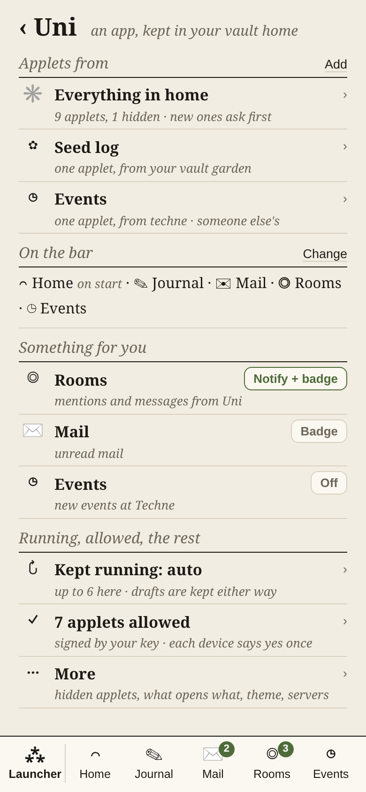
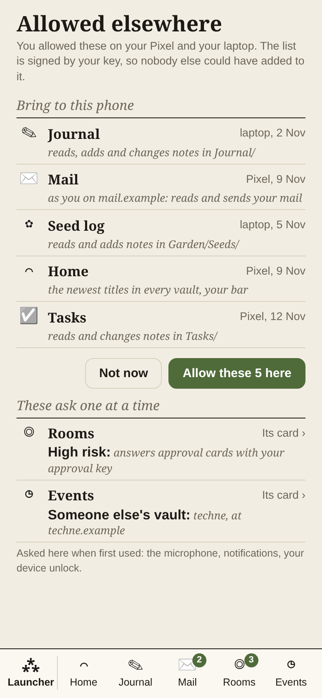

# The app record: one record says what your app is (design)

Status: a proposal, nothing built. It answers T-476: which applets an app loads, where they sit, who allowed them, what
they keep, and how they tell you something is waiting. Schemas, examples that validate and three mockups are in
[app-record/](app-record/). A fresh reviewer said NO-SHIP to the first draft; what changed is in
[The review](#the-review). Made-up names and hosts throughout (Aaron, Techne, `uni.example`), as in
[EMBED.md](EMBED.md).

**The short read:** the picture, the three screens, and the three questions at the end. The layers in between are
for whoever builds it.

## The picture

```
 YOUR HOME VAULT  (follows you to every device)          THIS DEVICE  (stays here)
 ┌───────────────────────────────────────────────┐      ┌────────────────────────────────────┐
 │ Parachute/Settings     your Parachutes, and   │      │ which app is open here             │
 │                        the app a new device   │      │ whose each vault is                │
 │                        opens                  │      │ your yes to what you allowed       │
 │ Parachute/Apps/uni     AN APP: where applets  │─────▶│   elsewhere                        │
 │                        come from, the bar,    │ read │ microphone, notifications, unlock  │
 │                        start, what opens what,│      │ what each applet saved: drafts,    │
 │                        signals, theme         │      │   where you were                   │
 │ Parachute/Grants       what you allowed,      │─────▶│ how many applets stay running      │
 │                        SIGNED BY YOUR KEY     │check └────────────────────────────────────┘
 └───────────────────────┬───────────────────────┘
                         │ an app lists applets; it never runs one
                         ▼
   everything in home  ·  Seed log from garden  ·  Events from techne.example (someone else's)

 PUSH GATEWAY (named by the applet, on its card): counts what is waiting while nothing runs ──▶ badge, notification
```

1. **An app is a record** in your home vault. It lists where applets come from (one applet, a whole vault, a whole
   hub) and how they are laid out. You can have several; each device opens one.
2. **A listing never runs anything.** An applet runs only for the exact code you allowed. What you allowed is one
   list signed by your key. Your other devices offer it to you in one tap, and nobody with only a vault token can
   add to it.
3. **An applet can stop at any moment and lose nothing.** The kit saves drafts and where you were as you go. How many
   applets stay running is then only about speed.
4. **An applet says what counts as "something for you".** A server counts it while the applet is closed. The same
   count is the badge on the bar and the notification on your lock screen.

## What a person sees

From [app-record/mockups/mockup-app.html](app-record/mockups/mockup-app.html) (`?screen=picker`, `settings`,
`allowed`).

| Your apps | One app's settings | What you allowed elsewhere |
|---|---|---|
|  |  |  |

**What to judge.** First: does "an app" read as a thing you pick, and is *Everything* a fair name for how it works
today? Second: do the three "Applets from" lines say wildcards in words you would use? (Hidden applets, what opens
what, theme and servers are behind **More**.) Third: is one tap for the ordinary ones, with Rooms and Techne's applet
asking by themselves, the right weight? That screen is open question 1.

## Two ways to say which applets an app has

| | **A. One list** | **B. Links** |
|---|---|---|
| The shape | One app record holds everything: sources (with wildcards), bar, start, opens, signals. | The app record is a title. Each applet in it is its own pointer record linked to the app, with its version pin, its place on the bar, its signal choice. |
| "Every applet in home" | One line. A new applet shows up by itself. | No wildcard. A button writes nine pointers; the tenth applet needs a tenth. |
| Reorder the bar | One write. | Up to twelve writes that must all land. |
| The version you trust | Not in the app. It is in the signed list of grants. | In each pointer (`code`), as pointers do today. |
| Two devices change it at once | The second write is told to read again (`if_updated_at`, as Settings does now). | Small records rarely collide, but the bar can end up half one order, half the other. |
| Your agent sets up an app | Writes one record. | Writes one per applet and keeps them in step. |
| Seen in the vault | One note to read. | The graph shows which apps use an applet. |

**Recommendation: A, with the pin in the grants.** Aaron's words ask for wildcards, and B can't have them. B's real
strength is a version pin per applet; the signed grants already hold the exact code hash per applet, and a pin a
token holder can't rewrite is a better pin. So there are two kinds of record: apps (lists; anyone who can write
your vault can edit them; they grant nothing) and the grants (only your key can make them). A list *and* links would
say the same thing twice. Links to another hub can't be vault links anyway: an applet in Techne's vault is named by
address, as the bar names it today.

## Layer 1: the app record

`Parachute/Apps/<id>` in your home vault, tagged `parachute-app`, everything under `fields.app`
([schema](app-record/app.schema.json)). The type is called an app; the tag carries the prefix because a plain `app`
tag is one people already use for their own notes. Applets can't write the record: their writes change a note's
words, never its fields, and `parachute-app` and `parachute-grants` join the tags whose notes an applet may not touch
(`GUARDED_TAGS`, `src/applet/modules/vault.ts`). Your agent can write it. That is the point, and it is safe because
nothing in it grants.

| Key | What it says |
|---|---|
| `id`, `name`, `glyph`, `note` | What the picker shows. |
| `sources` | Where applets come from (below). |
| `hide` | Applets a wildcard brings that this app leaves out. |
| `bar`, `start` | As in `Parachute/Settings` today: up to 12 places, and the home applet. Open-on-start still needs this device's tap, per app (`start.ts`, unchanged). |
| `opens` | Which applet opens a type of note in a vault when more than one can, or `null` for the plain vault view. Applets still declare what they *can* open; this picks among them. |
| `services` | The servers this app's applets reach, as Settings lists them today. |
| `theme`, `frame` | Which theme and frame record this app wears. |
| `keep` | How many applets stay running: `"auto"` or a number (layer 3). |
| `signals` | Which applets badge, notify or stay quiet (layer 4). Choices only; no server address. |
| `based_on` | Set when you added an app someone else offers: where the copy came from. |

**Sources.** One shape, `{ hub?, vault, applet }`, the same as a place on the bar. A `*` widens it:

```json
"sources": [
  { "vault": "home", "applet": "*" },
  { "vault": "garden", "applet": "Applets/SeedLog" },
  { "hub": "https://techne.example", "vault": "techne", "applet": "Applets/Events" },
  { "hub": "https://uni.example", "vault": "*", "applet": "*" }
]
```

Every applet in a vault; one applet; one applet in someone else's vault; every vault on a hub. No hub means the hub
your home vault is on. There is no "every hub" and no "this applet in every vault".

**How the app reads it**, each time it shows the launcher:

1. Pick the app: this device's choice, else `Settings.app`, else the only one, else the picker.
2. For each source, list what this device can see. A hub it isn't signed in to is one line with **Sign in**, as now.
3. Take away `hide`. Group as now: by Parachute, then vault; someone else's is marked.
4. `bar`, `start`, `opens` and signal rules that name an applet outside the list are skipped, not errors.
5. Tap one. It runs if this device has said yes to this exact code and these exact asks. Otherwise its card.

**Wildcards and changed code.** A wildcard decides what is *listed*. Your yes decides what *runs*.

| What happens | What you see |
|---|---|
| A new applet appears in a vault you listed with `*` | It is in the launcher, marked **New**. Its card on first open. |
| An applet's code changes | "«Rooms» changed" on the first device to open it. Your other devices then offer it under "Allowed elsewhere". |
| It asks for something else | "«Rooms» asks again", with what is new marked. |
| It is in someone else's vault | The same. It stays marked, gets nothing from the app, never opens by itself, and is never part of a one-tap batch ([EMBED.md](EMBED.md) otherwise unchanged). |

**Several apps.** Each is one record: *Uni* for every day, *Techne* for the shop. A device remembers which one it has
open. A new device opens `Settings.app`. The picker is the launcher's title, tapped. A vault that no source of the
open app names is reached through *Everything* or Settings.

**An app someone else offers.** Techne can keep an app record in its own vault. Your launcher offers **Add**. That
copies it into your home vault with `based_on`, its sources rewritten to name Techne's hub. The copy is yours: when
Techne changes theirs, the picker says so and shows what differs. Someone else's vault never moves your bar. (The
other answer, an app that follows Techne, is open question 2.)

**What stays in `Parachute/Settings`:** what is yours rather than one app's. `hubs` (your Parachutes) and `app` (the
app a new device opens). [Schema](app-record/settings.schema.json).

## Layer 2: what you allowed, signed, in the same vault

Today an Allow lives in one device's `localStorage` (`src/applet/grants.ts`). Every device asks about every applet
from nothing, and EMBED.md's rule is "no record grants anything", because anyone with a vault token can write a
record.

**The proposal keeps that rule.** A record still never runs code by itself. What changes is that your devices can
tell each other, in a way a vault token can't fake, what you already said yes to. A device then asks you once for
the lot instead of card by card.

**The record.** One: `Parachute/Grants`, tagged `parachute-grants` ([schema](app-record/grants.schema.json)). It
holds one Nostr event signed by your everyday key, never sent to a relay. Its content is the whole list: a counter
(`seq`), the id of the list it replaced (`prev`), and one entry per applet you allowed: which applet (hub, vault,
record), the hash of what it asks, **the hash of its code**, when it ends (a year at most), what its card said, and
three facts about the device that showed the card (its mode, whose it said the vault is, whether the card had a High
risk line). A revoke is the next list without that entry.

**What a device does with it.** It checks the signature, that the key is the one *this device holds*, and that `seq`
is not lower than the last list it saw. Then, for entries it has no yes for:

- Ordinary applets in your own vaults go on one screen, **Allowed elsewhere** (third mockup): each with its card's
  first line, where and when you allowed it, and one button. One real tap, on a screen the app draws.
- An applet with a High risk line, or in someone else's vault, is not in the batch. It shows its full card here.
- An entry made under another device mode, or where this device says the vault is someone else's and that one said
  yours, is ignored. The applet asks here as if new.

A new phone and a change you allowed on the laptop yesterday are the same screen. Your yes is kept on the device,
as grants are now.

**What each party can do:**

| Who | Can | Can't |
|---|---|---|
| Someone with a vault write token (an agent) | Delete the list: devices ask again. Put back an older signed list: a device that saw a newer one refuses it. | Add an applet, change a code hash, widen what one asks. ([grants-forged-code.json](app-record/examples/invalid/grants-forged-code.json) is that attempt.) |
| The same, against a device that never saw the newer list (a new phone) | Show it an old list, with something you since revoked on it. | Run it. It reaches the "Allowed elsewhere" screen, dated, and needs your tap; and only for code and asks you once allowed. |
| A malicious applet | Nothing here. The signer that works for applets refuses this event kind by name. | |
| This app's own shell, if compromised on one device | Sign a false list. That was already "run anything on this device"; now it also reaches the batch screen on your others. | Run anything on another device without your tap there, or put a High risk or foreign applet in a batch. |
| A device with no key (a browser tab) | Nothing: it has no key to check against, so it never reads the list. It asks for everything itself, as today. | |

**Three things must change in the code for this to hold**, all found in review:

1. **The scope hash must be the same on every device.** Today it isn't: `grantKey` takes this device's name for the
   vault (`home`, or `home@host` when two hubs share a name) and what this device says of other vaults. A new
   version hashes the hub's address and the vault's name instead.
2. **The list needs an event kind of its own.** The native signer already signs kind 30078 for applets under a
   prefix the applet declares (`private_save`, `src-tauri/src/services.rs`). The list uses a different kind (30479
   in the examples), signed by one native command no applet call reaches, with a test that the applet path refuses it.
3. **Native code signs what the web shell hands it.** The card is drawn by the shell, so "signed from what was on
   screen" can't be promised below the shell. This is why another device's signature only *offers*, and never runs.

**What stays on each device, and why:**

| Stays per device | Why |
|---|---|
| Your yes | The standing rule: only a real tap on this device starts code. |
| The microphone, notifications | The phone's own permission. Nothing we store can answer for it. |
| The approval key's slot and the device unlock | The unlock means a person is holding this device now ([KEYRING.md](KEYRING.md)). |
| Whose each vault is | The person's say on the app's own screen. Unchanged. |
| Sealed or approved-code mode | A fact about this device's sandbox. |
| Which app is open, open-on-start, "Always open with", the keep-running override | Choices about this device. Each wins over the record here. |

**A new device:** pair your key in and sign in to your home hub (as now; whose each vault is, is asked then). The app
reads Settings, your app and the list. **Allowed elsewhere** appears once. Rooms and Techne's Events show their own
cards when first opened. The microphone and notifications ask when first used.

**Which key signs: two answers.** The everyday key: it is there on every tap, and it already signs as you
everywhere. Or the approval key: stronger, but for most people it is the same key today, and it would put an unlock
on every Allow. **Lean: the everyday key**, because a signature here only offers.

## Layer 3: an applet's state survives everything

Aaron: "if I'm journaling and then hop to mail then messages and then rooms, I don't want to lose my journal entry.
Even if I close my app or turn off my phone."

Today an applet may ask for `storage` (256 KB in `localStorage`), and three hidden applets stay running (`KEEP = 3`,
`src/shell/kept.tsx`). Nothing is saved when a fourth pushes the first out. A draft survives only if the applet's
author thought to save it.

**The guarantee.** What an applet gives the kit to save is on this device's disk within 300 ms of changing, and is
handed back before the applet's first paint, whether it was hidden, unloaded, the app closed or the phone restarted.

```tsx
<textarea {...saved("draft:" + roomId)} />                  // a text box that can't lose its words
const [tab, setTab] = useSaved("tab", "inbox");             // where you were
```

- **Saved as you go, not on the way out.** The kit sends each change to the shell, at most 300 ms late. Nothing
  depends on an exit running, which is the only promise that survives the phone killing the app.
- **One last flush, where there is a moment for it.** The kit flushes when its frame is hidden, when the app goes to
  the background (`visibilitychange`, `pagehide`), and when the shell is about to unload it. That last now covers
  every applet, not only kept ones. The shell waits up to 250 ms for the answer, then unloads anyway.
- **Handed back at start.** Saved values arrive in the message that starts the applet, so it paints its draft at
  once. The kit also saves, for free, the screen the applet was on and its main scroll position.
- **Only what goes through the kit.** A plain `useState` box is lost as today. So step 1 of the migration converts
  our own applets: Journal's entry box, Rooms' and Mail's composers. WRITE-AN-APPLET.md makes `saved()` the way to
  write a text box.
- **Every allowed applet gets it,** without asking: it is the applet's own data on your own device. The `storage`
  word stays and means the same store, so no grant changes.
- **The store** moves out of `localStorage` (5 MB for the whole app) into the app's own data: a file per applet on
  phone and desktop, IndexedDB in a browser. 1 MB per applet, of which 256 KB is held back for drafts, so a cache
  can't crowd one out. A full store refuses the write and the kit tells the applet. Keyed hub + vault + applet
  record, on this device. **Forget this vault** clears it, and each applet's settings get "Clear what it saved";
  neither happens today. A revoke does not clear it: a card asking again must not cost you a draft.

**Local or synced: two answers.** (a) Saved state is this device's only. A draft that should follow you is saved by
the applet as a real note in its own folder, as Journal does with an entry. (b) The kit offers a synced flavour and
the shell writes it to your home vault. **Lean (a):** no new mechanism, and a half-written message turning up on
another device is a surprise. This is open question 3.

**Then keep-alive is only speed.**

- **Default `"auto"`: a count by device.** 6 hidden applets on a phone, 12 on a desktop, and all but the newest
  dropped when the system says memory is short. A count, not measured memory, because a web view can't reliably say
  what one frame costs (inferred, not measured).
- **The setting:** `keep` in the app record (`"auto"`, or 0 to 12), with an override on each device.
- A running applet keeps its connections open. That is the cost, and why an old phone might choose 2.
- What may be kept at all (own code, no embeds, no note handed in) stays as `kept.tsx` has it.

## Layer 4: "something for you"

Today only Rooms reaches you while closed. Its relay service carries `notify: { mentions, from, gateway }`; the push
gateway watches the relay and pushes "a message for you", no words, no count. Nothing shows a badge.

**The applet declares its signals** in `fields.signals`, beside its manifest
([schema](app-record/signals.schema.json)): an id, a name in plain words, how it counts, where from, and the gateway
that counts it.

```json
"signals": [
  { "id": "for-you", "name": "mentions and messages from Uni", "count": "new", "via": "https://push.example/",
    "from": { "service": "rooms", "mentions": true, "authors": ["3f1c…2b4d"] } }
]
```

| `from` | Counts | Who counts while the applet is closed |
|---|---|---|
| a relay service the applet declared | events naming you, or from keys this device trusts; `new` since you last looked | The gateway, as today, in the rooms it has been added to. |
| an http service it declared (`feed`) | a number that server reports | The server tells the gateway. The gateway never holds your mail login. New on both sides. |
| its own vault (`path`, `type`, `where`) | how many notes match now | Later: needs the hub to tell the gateway when a query's answer changes. Until then the app counts it each time the launcher shows. |

The gateway stays on the applet, as `notify.gateway` is today, so it is on the card and in what you allowed: a
rewritten record can't send your phone's address to a stranger's server, and two relays can use two gateways.

**The gateway keeps one number** per person, applet and signal.

**The app shows it without running the applet.** At start, on each push, and when the window comes back to the
front, the shell asks the gateway for your counts in one signed request. The bar and launcher draw them.

**The applet's own number wins while it runs.** Rooms knows what you have read; the gateway only knows what arrived.
Running, the applet sets the number and the shell tells the gateway, which tells your other phones, so a badge read
on one clears on the others.

**The same signal is the notification.** The push says which applet, which signal and the count. The phone words it
from the applet's own record: *Rooms · 3 new: mentions and messages from Uni*.

**In the app record**, `signals` holds your choices only:

```json
"signals": {
  "default": "badge",
  "rules": [
    { "vault": "home", "applet": "Applets/Rooms", "signal": "for-you", "show": "notify" },
    { "hub": "https://techne.example", "vault": "techne", "applet": "Applets/Events", "show": "off" }
  ]
}
```

`notify` is a badge and a notification; `badge` is quiet; `off` isn't registered at all. A device registers the
signals of the app it has open. One exception to "a record can turn it off": a signal that carries approval requests
can only be silenced on the device, so an agent can't quiet its own approval cards.

**What it costs, said plainly.** The gateway already knows your public key and your rooms. It would also learn which
applets you use, your mail's unread count, when you open the app and roughly when you read. It never sees words. A
desktop gets no push while closed (as today), so its badges are fresh at start and when you come back to the window,
not live. A room the gateway hasn't been added to never counts.

## Worked examples

All in [app-record/examples/](app-record/examples/), checked by [validate.mjs](app-record/validate.mjs).

- [app-uni.json](app-record/examples/app-uni.json): the everyday app in the mockups (below).
- [app-everything.json](app-record/examples/app-everything.json): today's behaviour as an app; what migration writes.
- [app-techne.json](app-record/examples/app-techne.json): an app added from Techne's vault, with `based_on`.
- [settings.json](app-record/examples/settings.json) and
  [settings-while-devices-overlap.json](app-record/examples/settings-while-devices-overlap.json).
- [grants-7.json](app-record/examples/grants-7.json): the signed list (Journal, Techne's Events, Rooms), and
  [grants-6-before-the-revoke.json](app-record/examples/grants-6-before-the-revoke.json), the list it replaced, which
  still had Scratch. Real signatures, from a key made for the examples and thrown away. The validator plays a
  device: having seen 7, it refuses 6.
- [signals-rooms.json](app-record/examples/signals-rooms.json),
  [signals-mail.json](app-record/examples/signals-mail.json),
  [signals-tasks.json](app-record/examples/signals-tasks.json): the three kinds of signal.
- [examples/invalid/](app-record/examples/invalid/): 22 records that must be refused, and are: every hub, a hub with
  a `*` in it, one applet in every vault, a version pin or `allowed` slipped into a source, a gateway slipped into
  the app, a theme that points at the grants, a forged list, an unsigned one, a ten-year grant.

```json
{
  "path": "Parachute/Apps/uni",
  "tags": ["parachute-app"],
  "fields": {
    "app": {
      "contract": 1,
      "id": "uni",
      "name": "Uni",
      "glyph": "◉",
      "note": "everyday: journal, mail, rooms",
      "sources": [
        { "vault": "home", "applet": "*" },
        { "vault": "garden", "applet": "Applets/SeedLog" },
        { "hub": "https://techne.example", "vault": "techne", "applet": "Applets/Events" }
      ],
      "hide": [{ "vault": "home", "applet": "Applets/Scratch" }],
      "bar": [
        { "vault": "home", "applet": "Applets/Journal" },
        { "vault": "home", "applet": "Applets/Mail" },
        { "vault": "home", "applet": "Applets/Rooms" },
        { "hub": "https://techne.example", "vault": "techne", "applet": "Applets/Events" }
      ],
      "start": { "vault": "home", "applet": "Applets/Home" },
      "opens": [
        { "type": "journal", "vault": "home", "applet": "Applets/Journal" },
        { "type": "task", "vault": "home", "applet": null }
      ],
      "services": [
        { "name": "Rooms", "kind": "nostr-relay", "url": "wss://relay.example" },
        { "name": "Mail", "kind": "http", "url": "https://mail.example/mail/" }
      ],
      "theme": "Parachute/Theme",
      "keep": "auto",
      "signals": {
        "default": "badge",
        "rules": [
          { "vault": "home", "applet": "Applets/Rooms", "signal": "for-you", "show": "notify" },
          { "hub": "https://techne.example", "vault": "techne", "applet": "Applets/Events", "show": "off" }
        ]
      }
    }
  }
}
```

One entry of the signed list, as it reads inside the event's content:

```json
{
  "subject": { "hub": "https://techne.example", "vault": "techne", "record": "01M7EVENTS", "applet": "events" },
  "scope": "0aa3eeee…", "code": "tsx:77f10000…",
  "under": "sealed", "whose": "theirs",
  "at": "2026-11-10T19:12:00.000Z", "expires": "2027-11-10T19:12:00.000Z",
  "face": ["Someone else's vault, techne at techne.example.", "Read notes in Events/"],
  "others": [], "device": "Pixel"
}
```

## From today to this

1. **Saved state first.** It is the sharpest pain and touches nothing else. Move `storage` to the new store (copy
   `parachute.applet-storage.v1:*` once), add `saved()` and `useSaved`, the flushes, the wait before unload; convert
   Journal, Rooms and Mail; raise the keep-running default.
2. **Apps, read only.** With no app record, the app behaves exactly as now: it reads Settings as an unwritten
   *Everything* app (every hub in `hubs`, `*`, with its bar, start and services).
3. **Apps, written.** The first change (a pin, a new app) writes `Parachute/Apps/everything`. While old and new
   devices overlap, the new app keeps Settings' `bar`, `start` and `services` in step with the app named in
   `Settings.app`, and remembers what it last wrote there. If it finds Settings different, an old device changed it,
   and that change is taken into the app record. `install-applets.ts` learns `--app`.
4. **Opens.** A device's "Always" choices stay on the device and keep winning there. The app record's `opens` is
   offered them once ("Use these on your other devices too?") for types it has no choice for.
5. **Applet pointers.** Each `Parachute/From/…/applet-*` pointer is read as a one-applet source. The pointer records
   stay in the vault until the overlap ends, so an old device keeps its brought-in applets. Component pointers stay
   for good; embeds own them.
6. **Grants.** Local grants keep working and stay the device's yes. One prompt, "Keep what you allowed in your vault,
   so your other devices can offer it?", signs the current ones under the new scope hash. A device with no key skips
   this.
7. **Signals.** Rooms' `notify` becomes a signal; the gateway learns counts. Rooms' card comes back once, because
   what it asks is worded anew. An applet with no signals keeps its grant.

**Subtract** (what this replaces, and when the old one goes):

| Old | Replaced by | Goes |
|---|---|---|
| `bar`, `start`, `services` in `Parachute/Settings` | the app record | when no device of yours runs the old app; the app can see that from who last wrote Settings |
| Applet pointers (`Parachute/From/…/applet-*`) | a source, and the code hash in the grants | same day |
| Every device asking card by card | the signed list and "Allowed elsewhere" | at step 6; the local grant store stays, as each device's yes |
| `parachute.applet-storage.v1` | the saved store | at step 1 |
| `KEEP = 3` | `keep` | at step 1 |
| `services[].notify` | `fields.signals` | one release after step 7 |
| "The launcher is for everything" (NAVIGATION.md rule 2) | the launcher is your app; *Everything* is one | at step 3 |
| "Always open with: never in a note" (`src/open/defaults.ts`) | still true per device; the record adds a default | at step 4 |

## What I did not verify

- That the hub can tell a server when a query's answer changes. I did not read the hub's code. Vault signals wait on
  it.
- That a web view can't measure one frame's memory. It is why I chose a count.
- That kind 30479 is free in the Nostr kind list. I did not look it up; any unused kind does.
- A mail server reporting a count to the gateway does not exist yet, on either side.
- "The app can see that no device runs the old app" needs each device to leave its version somewhere. Not designed.

## Open questions for Aaron

1. **What should it take for another device to run what you allowed?** Three answers: every device asks card by card
   (today); **one tap for the ordinary ones, with High risk and someone else's applets asking by themselves (my
   lean, the third mockup)**; or no question at all once a device "follows your key". The last is smoothest, and it
   means one careless Allow on the phone runs on the desktop unseen.
2. **Can an org's app be live, or only a copy?** Techne could hand you an app that follows their changes: they add an
   applet, it is on your launcher. I lean **copy only**: it is yours once added, and you are told when theirs
   changes. Live is easier for Techne and gives them a hand on your screen.
3. **Do drafts follow you between devices?** Start a journal line on the phone, finish it on the laptop. I lean
   **no, saved on the device**; an applet that wants this saves a real note. Yes means the kit writes drafts to your
   vault for every applet that asks.

## The review

A fresh reviewer (Fable, not the author) read the first draft against the code and said NO-SHIP. Its objections and
what changed:

| Objection | Answer |
|---|---|
| A device with no key has nothing to check a grant against; a token holder could sign with their own key. | A keyless device never reads the list. Layer 2, "What each party can do". |
| Revokes could be undone by putting back an older record; order was by wall clock. | One signed list with a counter and `prev`, not a record per applet. A device refuses a lower `seq`. What remains (a device that never saw the newer list) reaches only the batch screen, and is stated. |
| The scope hash differs between devices (`grantKey` takes the device's vault key and its *whose*). | Confirmed in `useApplets.ts` and `vault/store.ts`. A new hash over hub and vault name; each entry records mode and *whose*, and a device that differs ignores it. |
| The native signer already signs kind 30078 for applets under any declared prefix, `parachute-grant:` included. | Confirmed in `services.rs`. The list gets a kind of its own that the applet path refuses, with a test. |
| "Built by the native side from the card on screen" can't be promised; a shell compromise would grant on every device for a year. | Dropped the claim. A signature from another device now only offers; running needs a tap on each device. |
| The draft guarantee was opt-in, flushed only for kept frames, promised "before hidden" over async messages, and said nothing of a full store. | `saved()` for text boxes, our applets converted in step 1, flush on background and before any unload with a 250 ms cap, a full-store rule, and the promise reworded to what holds. |
| One Allow anywhere became Allow everywhere, and that wasn't put to Aaron. | It is now open question 1, with the careful answer as the lean and High risk and foreign applets kept out of the batch. |
| The gateway moved into an agent-writable record, out of what the grant covers. | Moved back onto the applet's signal (`via`). The app record can't name a gateway; the schema refuses it. |
| Signals: privacy costs unstated; "no polling" untrue on desktop; other devices' badges; approvals could be silenced; the trusted-keys filter dropped. | "What it costs, said plainly" added; desktop said honestly; the gateway tells other phones; approval signals can't be turned off by a record; the filter kept. |
| Migration: the settings schema refused the dual-write; old devices drift; removing pointers breaks old devices; "Always open with" is per device and can mean the plain view. | Schema allows the overlap; a reconcile rule; pointers stay through the overlap; `opens` takes `null` and the device's choice wins. |
| Schemas allowed `https://*`, an id unlike its path, a theme pointing at the grants or climbing out, URLs with logins, duplicate bar places and signal ids, `../` in a signal path, a grant ending in year 9999. | All refused now, each with an example in `examples/invalid/` that fails for that one reason. `start` in someone else's vault can't be said in a schema; the app checks it, as today. |
| The tag `app` is too generic to guard. | `parachute-app`. |
| Wrong citation (PERMISSIONS.md), a name clash (`useKept` exists), 4,700 words, mockup mismatches, no mockup of the new-device screen. | Citation removed; `useSaved`; shorter, with what we borrow moved to the appendix; mockups matched to the examples; third mockup added. |

## Appendix: what we borrow

| From | What it does | What we take | What we leave |
|---|---|---|---|
| **Android** | Apps declare shortcuts and notification channels; the person pins and mutes them. Permissions are asked at use, per device. A process can die at any time, so state is saved as you go. Dots on icons come from notifications. | Signals are channels: the applet declares, you choose. Badge and notification are one signal. Layer 3 is Android's rule: being killed is normal. | A launcher whose layout lives apart from the apps. |
| **PWA manifest** | One JSON: `start_url`, `shortcuts`, `file_handlers`; a badge set from a push. | What an applet opens is declared by it and chosen by you. A push sets the badge. | One manifest per app, with no way to compose several. |
| **Tauri capabilities** | Files apart from the config say which windows (by glob) get which permissions. | Wildcards choose what is in scope; permission is a separate file. That is sources and grants. | Permissions fixed at build time. |
| **Obsidian** | `community-plugins.json` in the vault is a plain list of enabled plugins, and syncs. A device still asks once whether to trust the vault's plugins. | The list lives in the vault, and each device asks once. | No code hash: a synced plugin update runs unasked. We pin. |
| **Nostr NIP-89** | An app publishes "I handle kind K"; a person signs "for K, I use this one". | The same split: an applet's `opens` says what it can open; yours picks. | Publishing it to relays. |
| **Nostr NIP-78, NIP-51** | Signed, replaceable events hold an app's data and a person's lists. | The envelope for the grants list. | Relays as the store. Ours is the vault. |
