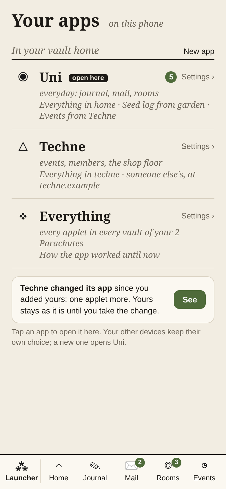
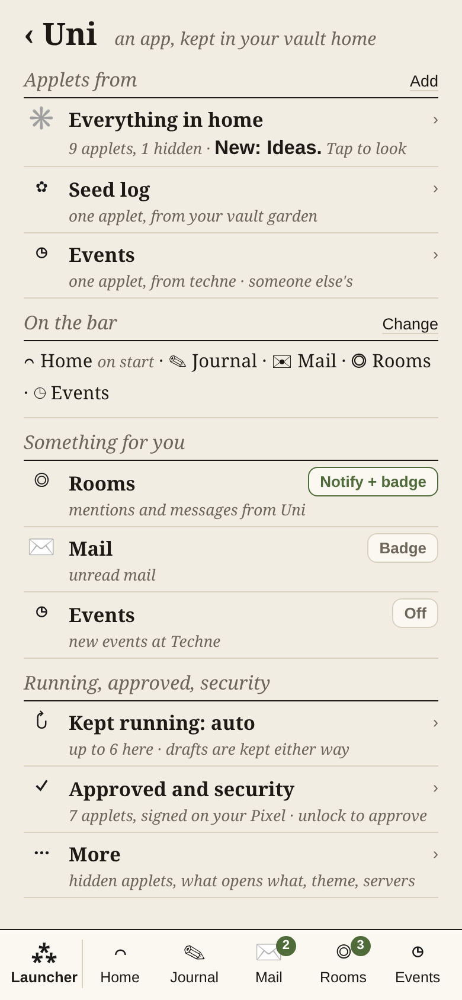
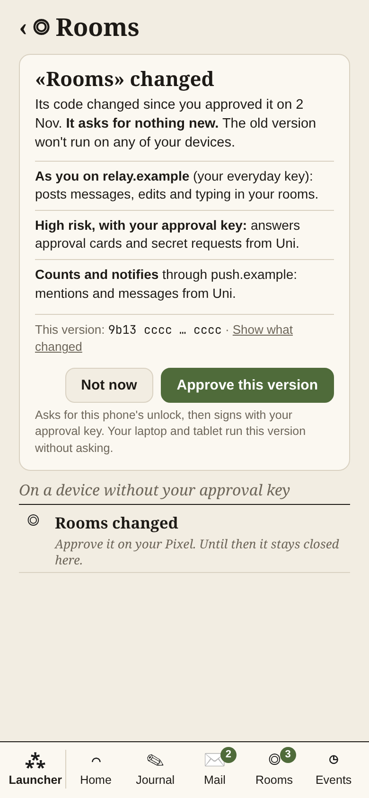

# What your Parachute app is: the one-page version

A proposal for T-476. Nothing is built. The full design, with every layer, is [../APP-RECORD.md](../APP-RECORD.md).

```
 YOUR HOME VAULT                                           EACH DEVICE
 ┌──────────────────────────────────────────────┐         ┌──────────────────────────────┐
 │ AN APP        what is offered: applets from  │ ──────▶ │ shows it                     │
 │               here, there, "everything in…"  │         │                              │
 │ APPROVALS     what may run: this exact code, │ ──────▶ │ checks the signature and that│
 │               signed by your approval key    │         │ it is the same code, then    │
 │                                              │         │ runs it                      │
 │ KEY LIST      which keys are yours now,      │ ──────▶ │ checks it against your root  │
 │               signed by your root key        │         │ key's public half            │
 └──────────────────────────────────────────────┘         └──────────────────────────────┘
        ONE device holds the approval key and signs, after its unlock.
```

## Seven things

1. **An app is one record in your home vault.** It says where applets come from: one applet, every applet in a
   vault, every vault on a hub. It also holds the bar, the home applet, what opens which kind of note, which applets
   may badge or notify. You can have several apps (Uni, Techne); each device opens one.
2. **Being listed never runs anything.** A new applet in a vault you listed shows as "New: Ideas. Tap to look."
   Code starts only when your approval key has signed "this exact code, asking exactly this", on a real device,
   after its unlock. One device approving is enough; the others check and run. Code changed means the hash changed,
   so it stops everywhere until you approve again. A vault or hub that is broken into has no key, so it can't get
   your everyday key used for anything new.
3. **Your keys are a short list signed by a root key you keep offline.** You make the root key once, in the app, and
   write it down. Replacing a key you still hold is a planned swap in which nothing stops. Replacing a leaked one is
   one signed update: the old key stops counting the moment a device reads it, and you approve your applets again
   from a device the thief never held. Someone who wants none of this needs no root key.
4. **An applet can stop at any moment and lose nothing.** The kit saves what you type as you type it. Hop from
   Journal to Mail to Rooms, close the app, restart the phone: the draft is there. How many applets stay running is
   then only about speed (6 on a phone, 12 on a desktop, yours to change).
5. **An applet says what counts as "something for you".** A server counts it while the applet is closed. The count
   is the badge on the bar, and the same signal is the notification.

6. **How careful the app is, is yours to set**, once, for every app and device. Approving code always takes your
   fingerprint or PIN. Routine approval cards take it each time by default (today there is a five-minute grace). You
   can also lock the whole app after so many idle minutes. A record can make a device stricter, never looser.
7. **A tapped note opens in** the applet you chose on this device ("Always"), else the one your app record names for
   that kind, else the only applet that opens that kind, else it asks; with none, the plain view. A link into
   another vault opens in an applet from that vault.

## What you would see

| Your apps | One app's settings | Approving a change |
|---|---|---|
|  |  |  |

**What to judge:** does "an app" read as a thing you pick; do the "Applets from" lines say wildcards in your words;
is the approval card clear that one yes covers every device.

## Listed or linked?

Listed, in one record, because you asked for wildcards and links can't have them. It matters less than it looked:
listing is only discovery, and trust is the signed hash. Nothing depends on graph links.

## How I know the approval rule holds

A small script plays 47 attempts against the rule: new code slipped into the vault, a changed component, an edited
hash, an approval signed by a stranger or by your everyday key, last month's approval put back, a withdrawn one put
back, a stolen approval key after you replaced it, a changed frame. Each does what the design says. A second script
turns off each of the rule's 25 checks in turn: the first fails without 16 of them; the other 9 refuse malformed
records or sit behind another check. It tests the rule, not an app: none of this is built.

Three gaps remain, each stated in the design: a device can't know about a withdrawal the vault hides from it; a
brand-new device will run an older version you once approved; and a stolen approval key together with a broken-into
vault can fool a device that hasn't read your new key list (which is why the list also goes to your relay).

## Decided, unless you say otherwise

- A **separate approval key becomes required**. Today it is usually your everyday key, which other software holds.
  Cost: what Uni sealed to the old key is sealed again.
- Approvals last **a year**. Drafts **stay on the device**. The push gateway learns which applets you use and your
  mail's unread count (never words).
- A device you haven't set up with your root key's public half (a browser tab, say) can't check approvals. It keeps
  today's behaviour: its own Allow, for itself.
- The **root key is made in the app, once, and shown as words** to keep off any device. To sign a new key list I
  lean typing those words into the phone behind its unlock (quick); signing on a machine that is never online is
  the stricter way.
- Every approval card carries the phone's warning ("on a phone an applet could send what it reads to the
  internet"), since one approval now covers every device. Someone else's applets may keep drafts on your device.
- Not designed here: dropping reactions from Rooms. It changes what Rooms may sign, so Rooms would ask once.

## Three questions only you can settle

1. **Approval key on one device, or two?** One is strongest; then a changed applet waits for your phone. I lean two:
   the phone and one more.
2. **Can an org hand you an app that follows their changes, or only a copy?** I lean copy only; you are told when
   theirs changes. Either way their code waits for your approval.
3. **Who may replace your everyday key: only the root key, or the approval key too?** Root only is the plain rule
   and slow. I lean: the approval key may swap the everyday key (never itself), so a leak is a two-minute fix on
   your phone. The design is written for root only; a yes adds one rule.
